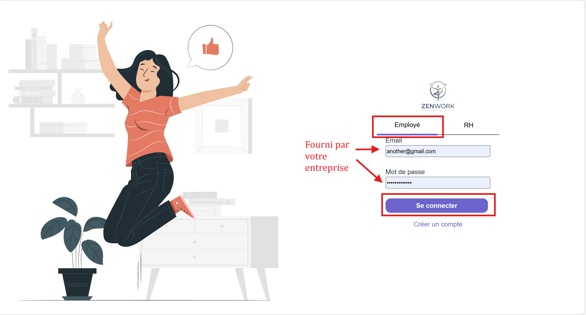
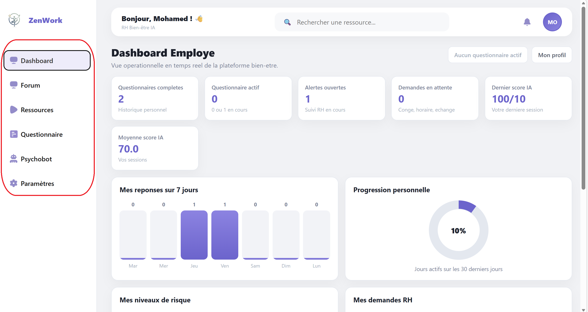
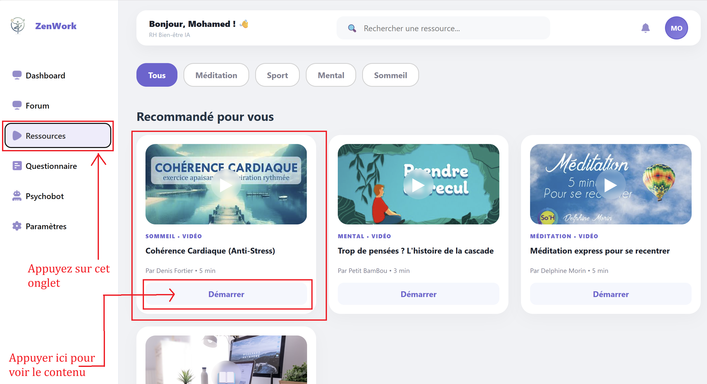
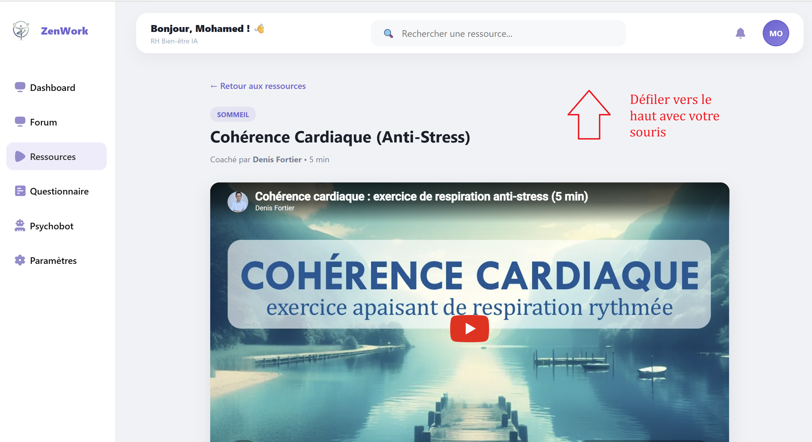
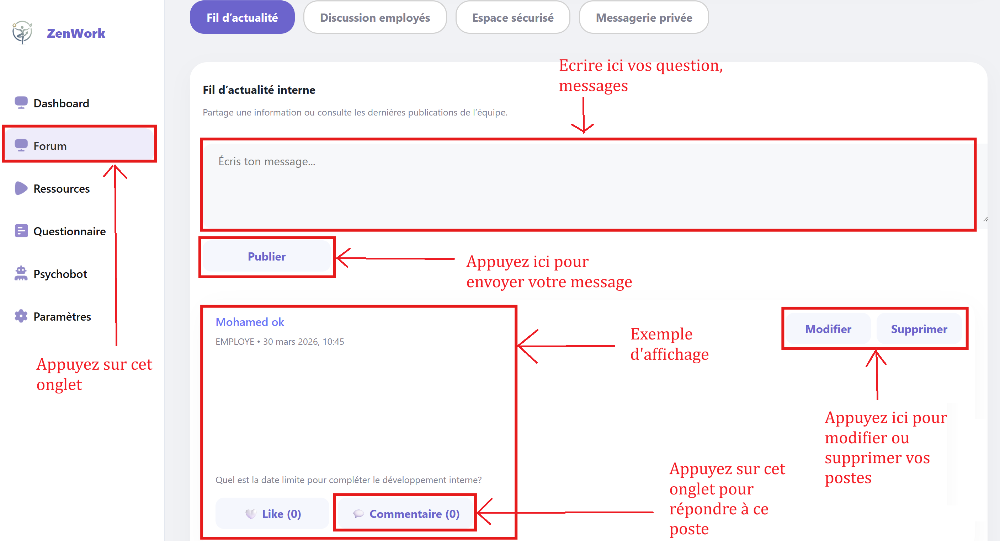
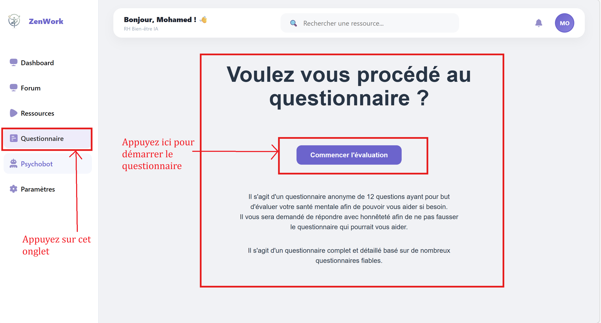
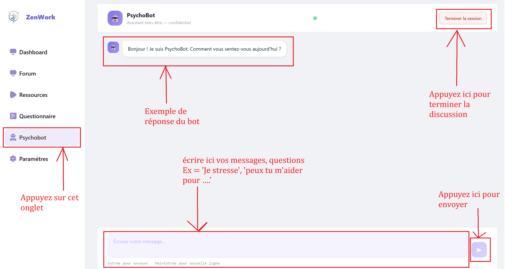
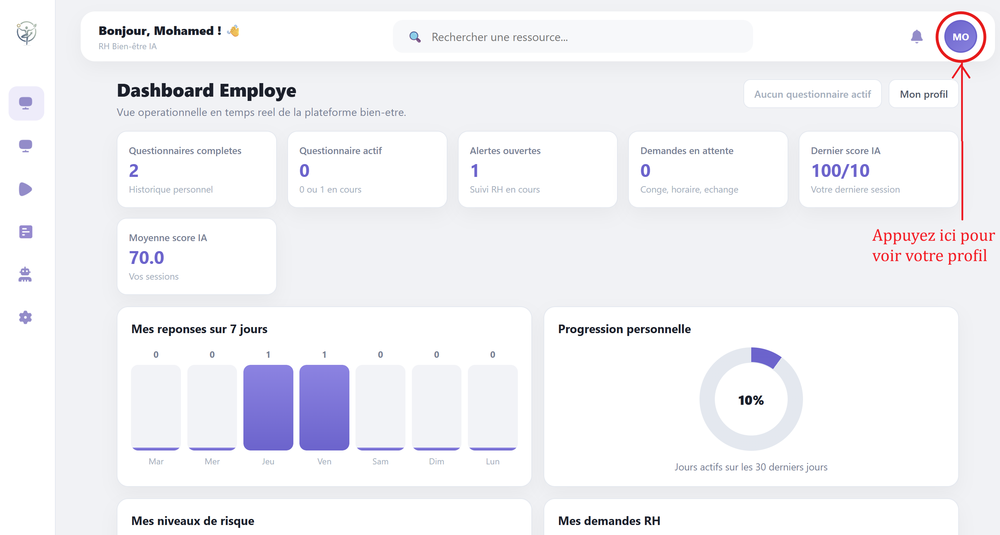
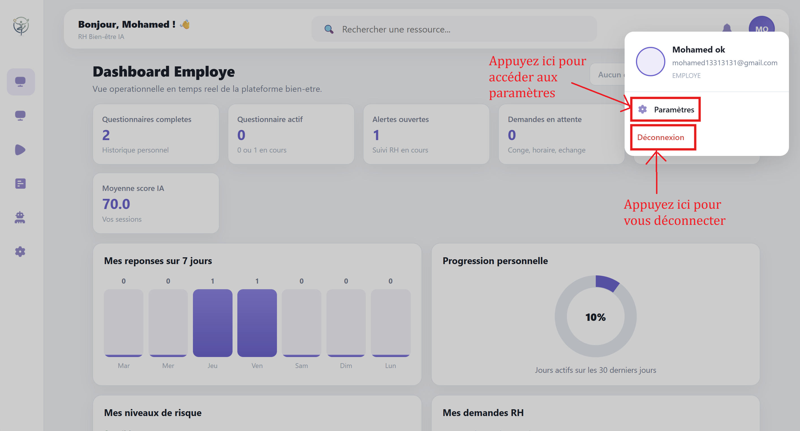
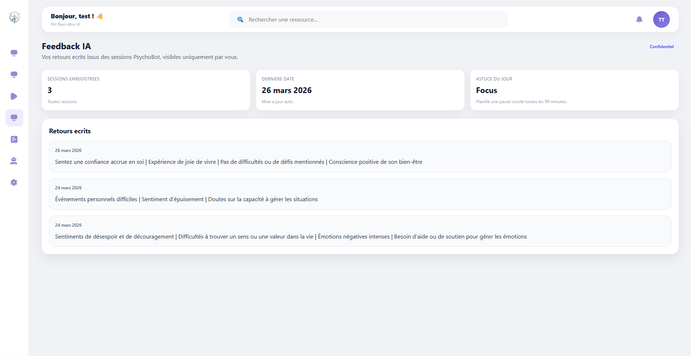

Manuel Utilisateur : Plateforme ZenWork

Bienvenue sur ZenWork, votre espace dédié au bien-être mental et à l'épanouissement au travail. Ce manuel vous guidera pas à pas pour prendre en main la plateforme et profiter de tous ses outils.

1. Connexion à la plateforme
   Pour accéder à votre espace personnel, rendez-vous sur la page d'accueil de ZenWork.

Sélectionnez l'espace Employé.

Entrez vos identifiants fournis par votre entreprise.

Cliquez sur le bouton de connexion.

2. Découverte de l'interface
   Une fois connecté, vous arrivez sur votre environnement de travail. La navigation se fait très simplement grâce au menu latéral gauche (Sidebar) :

Dashboard : Votre tableau de bord principal avec un résumé de votre activité.

Forum : L'espace d'échange avec vos collègues.

Ressources : Votre médiathèque bien-être.

Questionnaire : L'outil d'évaluation pour suivre l'évolution de votre bien-être mental.

Psychobot : Votre assistant virtuel d'écoute.

Paramètres : La gestion de votre compte.

3. L'Espace Ressources (Vidéos et Articles)
   Cet espace vous propose des contenus courts (environ 5 minutes) pour vous aider à gérer votre journée (stress, concentration, sommeil).

Comment trouver une ressource ?

Cliquez sur Ressources dans le menu de gauche.

Utilisez les boutons de filtres en haut (Mental, Sommeil, Méditation, etc.) pour trier les contenus selon votre besoin immédiat.

Sur la carte qui vous intéresse, cliquez sur le bouton Démarrer (pour une vidéo) ou Lire (pour un article).

Visionner une ressource :
La vidéo ou l'article s'ouvrira directement au centre de votre écran. Vous n'avez pas besoin de quitter ZenWork. Une fois terminé, cliquez simplement sur le bouton "← Retour aux ressources" en haut à gauche pour revenir à la grille.

4. Le Forum de discussion
   Le forum est un espace bienveillant pour échanger avec vos collaborateurs.

Cliquez sur Forum dans le menu.

Vous pouvez lire les sujets existants ou créer une nouvelle discussion pour poser une question ou partager une astuce bien-être.

5. Les Questionnaires (Bilan Bien-être)
   Pour vous aider à faire le point sur votre état d'esprit et vos conditions de travail, ZenWork met à votre disposition des évaluations régulières. Ces bilans permettent à la plateforme de vous recommander les meilleures ressources.

Comment remplir un questionnaire ?

Cliquez sur "Questionnaires" dans le menu latéral.
Cliquez sur le bouton pour démarrer l'évaluation disponible (ex: _Bilan mensuel_, _Niveau de stress_).
Laissez-vous guider et répondez aux questions avec sincérité.
À la fin du questionnaire, vos résultats sont enregistrés et vous recevrez des recommandations personnalisées.

6. Le Psychobot (Assistant Virtuel)
   Si vous ressentez le besoin de vous exprimer ou si vous traversez un moment de surcharge mentale, le Psychobot est là pour vous écouter 24h/24 et 7j/7.

Cliquez sur Psychobot dans le menu.

Tapez votre message dans la zone de texte. Les échanges sont totalement confidentiels et gérés par notre Intelligence Artificielle pour vous proposer des exercices de relaxation ou des conseils adaptés.

7. Le système de notifications

L'icône de cloche en haut à droite affiche un badge rouge avec le nombre de notifications non lues. Cliquez dessus pour ouvrir le panneau : il liste vos dernières notifications (catégorie, titre, contenu, date, statut lu/non lu). Cliquer sur une notification non lue la marque comme lue. Le bouton « Tout marquer comme lu » acquitte tout en une fois.

Pour les RH : lorsqu'un employé déclenche une alerte burnout, la notification précise son nom et le niveau d'urgence. La section « Activité récente » du Dashboard RH reprend ces alertes avec le statut de traitement (Nouveau, En cours, Traité) et permet d'accéder à la page Employés pour consulter le profil complet.

8. Gérer son profil et se déconnecter

Cliquez sur l'icône de vos initiales en haut à droite pour ouvrir le menu rapide.

- Paramètres : modifiez votre mot de passe (min. 10 caractères) ou vos informations personnelles (nom, prénom, service, date d'embauche).
- Déconnexion : ferme votre session de manière sécurisée.

9. Voir les retours de l'IA sur vos échanges
   

- On va là bas pour voir un résumé cours et rapide qui nous explique ce que l'ia pense et retient de nos derniers échanges.

- On peut y retrouver le nombre de sessions que nous avons fais, les dates de nos échanges, ainsi que des astuces mise chaque jours qui peuvent aider les employés à aller mieux.
